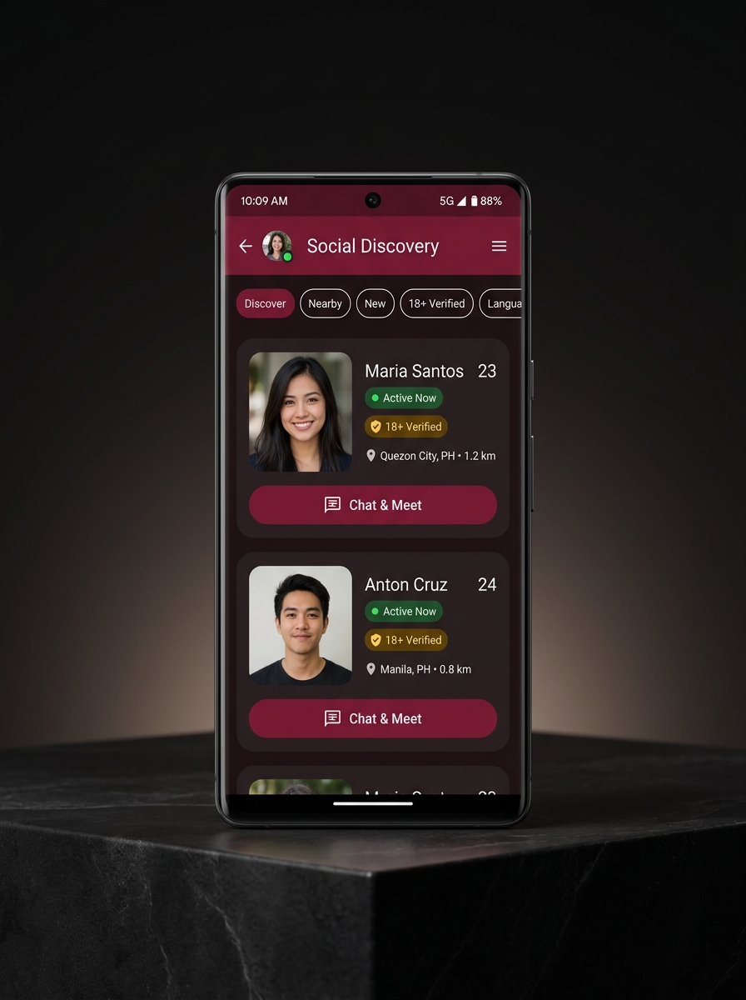
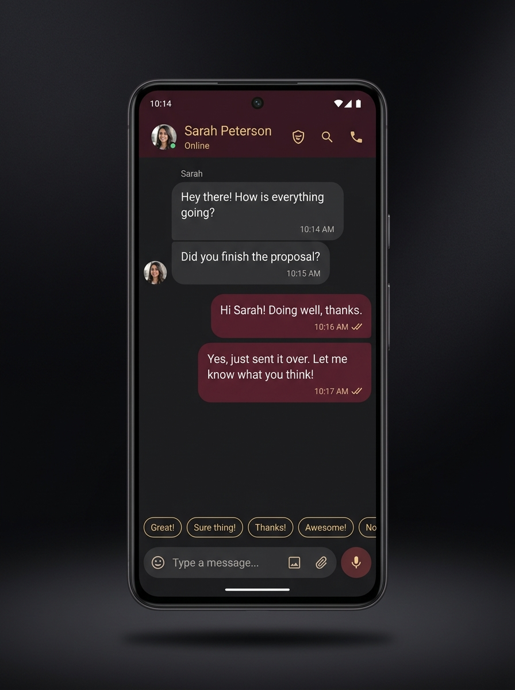

# SOGO CHAT AND MEET

**Private 18+ Social Discovery & Real-Time Private Chat for Android**

*Matte Obsidian • Royal Burgundy • Champagne Gold*

[-6D1226?style=for-the-badge&logo=android&logoColor=D4AF37)](https://developer.android.com)

 

---

## Ano ang SOGO CHAT AND MEET?

Ang **SOGO CHAT AND MEET** ay isang modernong Android social discovery at one-on-one private chat app na ginawa para sa mga **18+ verified adults** sa Pilipinas at sa buong mundo. Idinisenyo ito sa malinis at marangyang **Dark Burgundy & Champagne Gold** interface na mabilis, magaan, at may kumpletong privacy controls.

### Mga Pangunahing Features
- **One-Tap Google Sign-In:** Mabilis at ligtas na pag-login gamit ang iyong Google account—hindi na kailangan gumawa ng bagong password.
- **18+ Age-Verified Onboarding:** May automatic birthday validation para siguradong 18 years old pataas lang ang maaaring sumali.
- **Live Member Discovery & Smart Filters:** Makikita agad kung sino ang **Online Now** at puwedeng mag-filter ayon sa **Gender**, **Location** (*Philippines 🇵🇭* o *Overseas 🌏*), **Age Range** (*18–24, 25–34, 35+*), o mag-search gamit ang pangalan, lungsod, at hobbies.
- **Private 1-on-1 Chat & Read Receipts:** Real-time messaging na may *Sent (✓)* at *Read (✓✓)* checkmarks, at may built-in Pinoy conversation starters (*"Kumusta! 👋"*, *"Tara kape? ☕"*, *"Kain tayo! 🍲"*).
- **Kumpletong Safety & Account Controls:** May instant **Block Member**, **Report Member**, Online/Offline visibility toggle, Profile Editor, at permanent **Delete Account** option.

---

## App Photos & Screen Previews

| Live Social Discovery Feed | Private One-on-One Chat |
| :---: | :---: |
|  |  |
| *Real-time online indicator, 18+ verified badges, location tags, at one-tap "Chat & Meet" button.* | *Clean dark-mode chat bubbles, gold read receipts, quick reply chips, at safety controls.* |

---

## Paano Gamitin ang App (Step-by-Step Guide)

### Step 1: Mag-Sign In Gamit ang Google
Buksan ang **SOGO CHAT AND MEET** at pindutin ang **Continue with Google**. Piliin ang Google account na nais mong gamitin para awtomatikong ma-verify ang iyong login.

### Step 2: Kumpletuhin ang Iyong 18+ Profile
Sa unang pagbukas, ilagay ang iyong basic profile details:
1. **Display Name** at **Birthday** *(kinakailangang 18+ taong gulang pataas)*.
2. **Gender**, **Country**, at **City** (hal. Manila, Quezon City, Cebu, o Overseas).
3. **Personality** vibe, **Interests**, at maikling **About Me** bio.
4. Pindutin ang **Complete Profile** para makapasok sa dashboard.

### Step 3: Maghanap at Mag-Filter ng Members
Sa **Main Dashboard**, makikita mo ang bilang ng mga online members sa itaas:
- Gamitin ang **Search bar** para maghanap gamit ang pangalan, city, o interests.
- I-tap ang mga **Filter Chips** (*Online Now*, *Women / Men / Non-Binary*, *Philippines / Overseas*, *18–24 / 25–34 / 35+*) para mabilis mahanap ang gusto mong kausap.

### Step 4: Tingnan ang Profile at Makipag-Chat
- Pindutin ang **Chat & Meet** sa kahit sinong member card.
- Sa **Member Profile** tab, makikita ang buong bio, personality, at interests.
- Lumipat sa **Private Chat** tab o pindutin ang **Start Private Conversation** para mag-send ng mensahe o quick stickers.

### Step 5: I-Manage ang Privacy, Status, at Safety
Buksan ang **Options Menu (`⋮`)** sa kanang itaas ng Dashboard o Chat screen:
- **Edit My Profile:** I-update ang iyong bio, city, personality, o interests anumang oras.
- **Set Status Online / Offline:** Itago o ipakita ang iyong active green dot status.
- **Block / Report Member:** Nasa loob ng bawat profile at chat menu para sa agarang proteksyon.
- **Support SOGO • Watch Ad (+1 ⭐):** Opsyonal na panoorin ang maikling rewarded ad para suportahan ang app.
- **Delete Account:** Permanenteng burahin ang iyong profile at login kung nais umalis.

---

## Paano I-Install ang APK sa Android

1. I-download ang **`SOGO-CHAT-AND-MEET.apk`** file mula sa opisyal na **Releases** page ng repository na ito (o mula sa ibinigay na APK link).
2. Sa iyong Android phone (**Android 7.0 Nougat / API 24 o mas bago**), buksan ang downloaded `.apk` file mula sa **Files / Downloads**.
3. Kung hihingi ng pahintulot ang phone, i-tap ang **Settings** → i-enable ang **Allow from this source** (*Install unknown apps*), pagkatapos ay i-tap ang **Install**.
4. Buksan ang **SOGO CHAT AND MEET** mula sa iyong home screen at mag-sign in gamit ang Google.

> **Paalala sa Bersyon (V1.0):** Ang kasalukuyang bersyon ay naka-focus sa real-time member discovery at private text/sticker messaging. Ang live voice/video calling at chat photo/voice attachments ay naka-marka pa bilang *Not Implemented Yet* sa loob ng app.

---

**Package ID:** `com.sogo.chatandmeet` • **Minimum Android:** 7.0 (API 24) • **18+ Community Guidelines Enforced**

